# Lab 01: Windows – Cài đặt, bàn giao máy và xử lý sự cố

## Mục tiêu
Cài Windows 10 Pro trên máy ảo, thiết lập máy theo checklist bàn giao,
sao lưu và khôi phục dữ liệu, tự tạo và xử lý các sự cố thường gặp.

## Môi trường
- VMware Workstation 17.5, Windows 10 Pro 22H2 (64-bit) – Build 19045.3803
- 4 GB RAM, 2 CPU cores, ổ hệ thống C: 60 GB (NTFS), ổ phụ Backup D: 10 GB (NTFS)

---

## Các bước thực hiện

### 1. Tạo máy ảo

Tôi tạo máy ảo mới trong VMware Workstation bằng cách dùng New Virtual Machine Wizard, chọn cài thủ công (không dùng Easy Install) để có thể thực hành từng bước. Máy được đặt tên **LAB-Win10-01**, cấu hình 4 GB RAM, 2 CPU, ổ đĩa 60 GB (split), card mạng NAT.

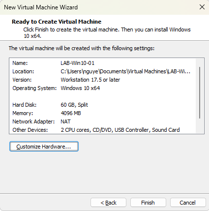

---

### 2. Cài đặt Windows

Boot từ file ISO Windows 10 Pro, chọn phiên bản **Windows 10 Pro x64**, tiến hành cài trên toàn bộ phân vùng 60 GB chưa được định dạng (unallocated). Quá trình cài đặt tự động tạo các phân vùng System Reserved và Recovery.

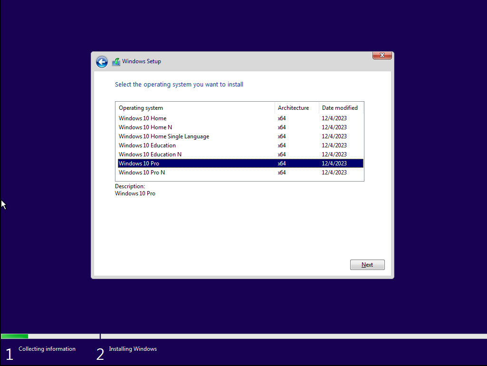
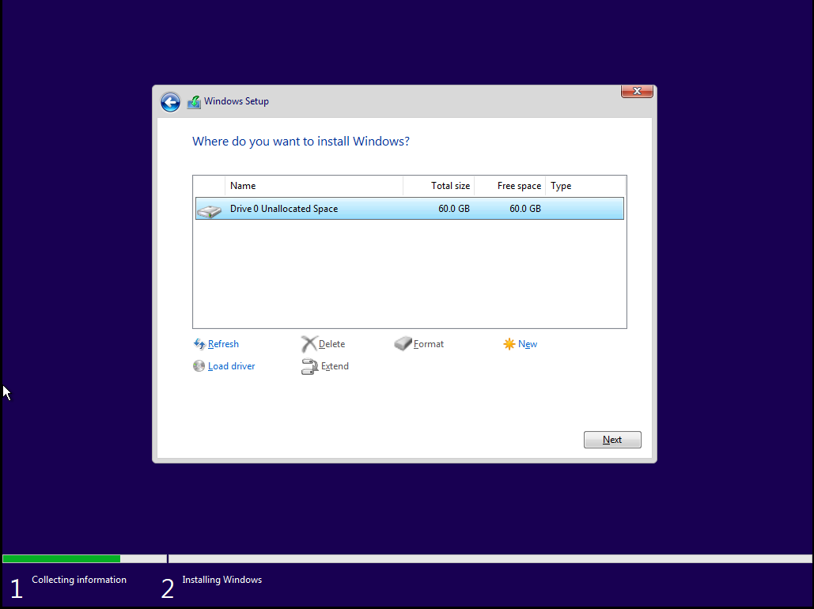

---

### 3. VMware Tools và cập nhật

Sau khi cài xong Windows và kiểm tra phiên bản qua `winver` (Build 19045.3803), tôi cài VMware Tools để có driver đồ họa, clipboard dùng chung và tính năng kéo–thả giữa máy thật và máy ảo. Sau đó tạo snapshot **01-Clean-Install** trước khi tiến hành bất kỳ thay đổi nào tiếp theo.

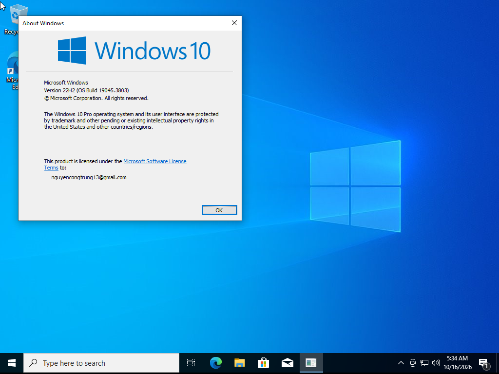
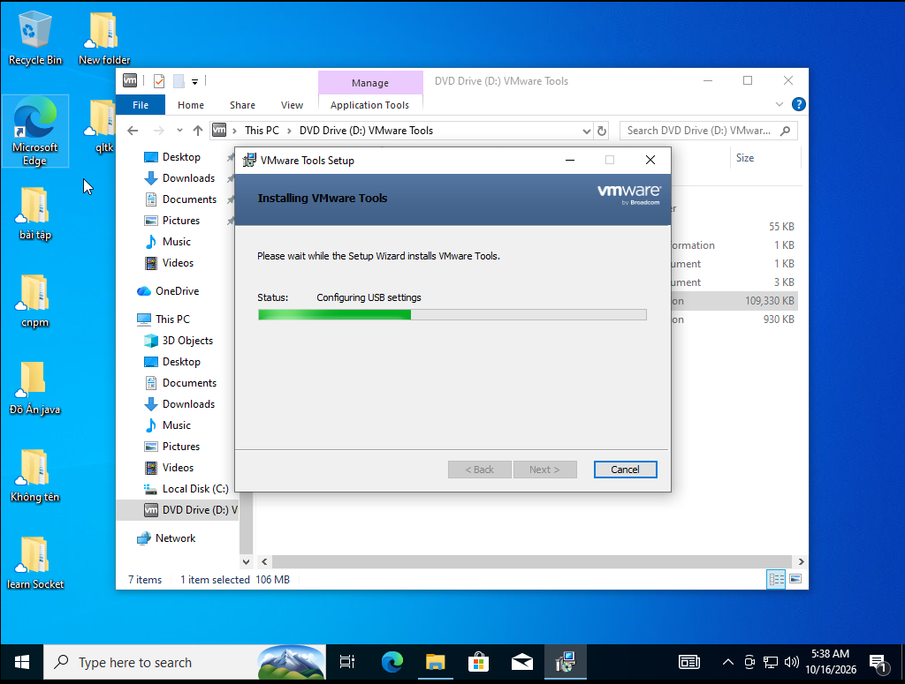
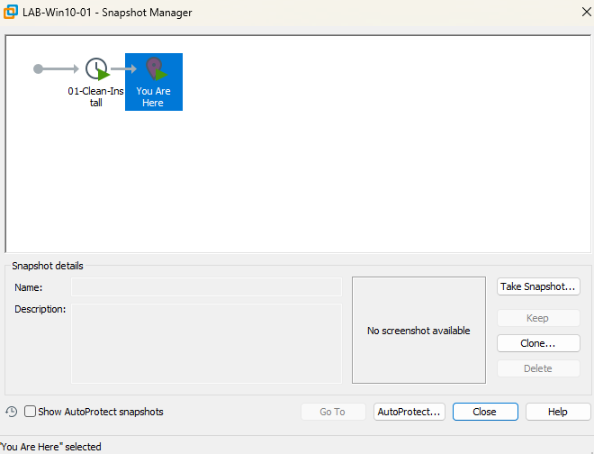

---

### 4. Bàn giao máy mới

**Đổi tên máy:** Vào *Settings → System → About → Rename this PC*, nhập **PC-KETOAN-01** rồi khởi động lại để áp dụng. Sau khi reboot, kiểm tra lại tên máy qua `sysdm.cpl` hoặc hộp thoại About.

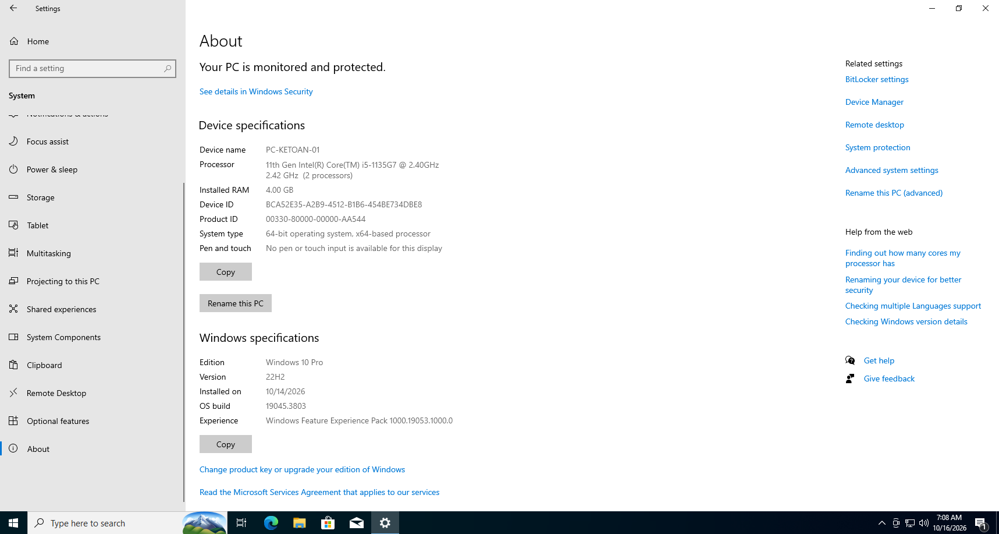

Tạo tài khoản **nguye** (quản trị) và **user01** (người dùng thường) qua `lusrmgr.msc`. Kiểm tra phân vùng đĩa qua Disk Management và đảm bảo Windows Security không có cảnh báo.

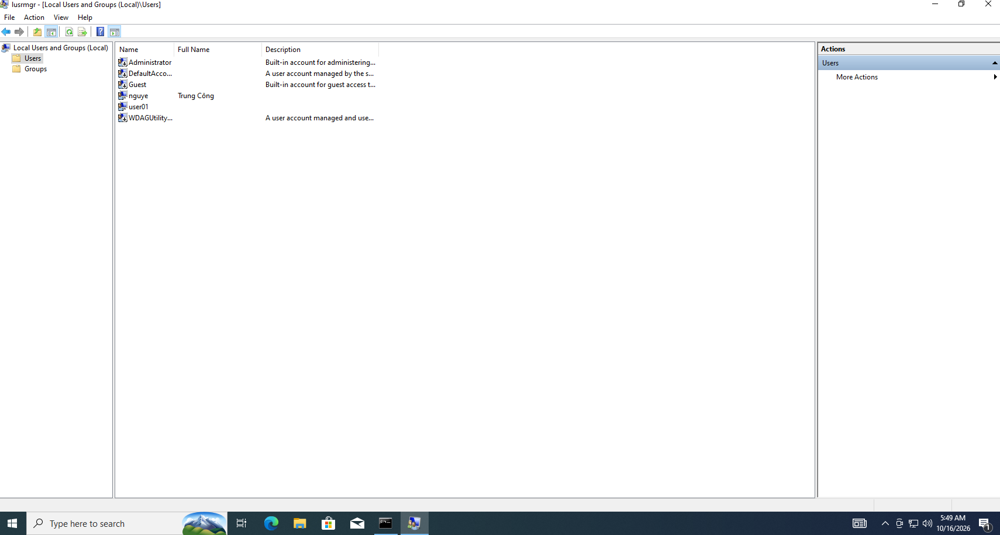
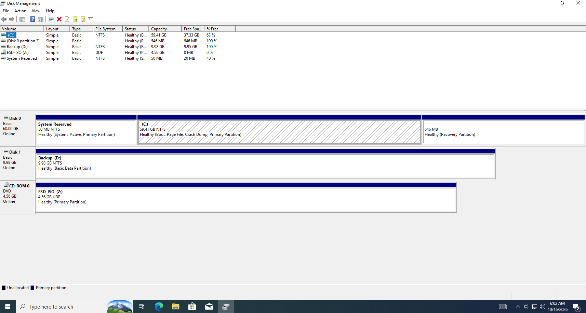
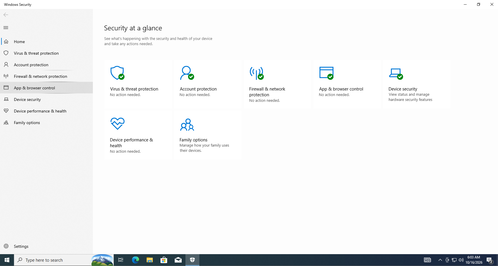

**Checklist bàn giao:**

| Hạng mục | Giá trị |
|---|---|
| Tên máy | PC-KETOAN-01 |
| Tài khoản quản trị | nguye |
| Tài khoản người dùng | user01 |
| Hệ điều hành | Windows 10 Pro 22H2 – Build 19045.3803 |
| Ổ hệ thống | C: 59.41 GB NTFS – còn trống 37.33 GB |
| Ổ sao lưu | Backup D: 9.98 GB NTFS |
| Antivirus | Windows Defender – bật, không cảnh báo |
| Firewall | Windows Firewall – đang bật |
| VMware Tools | Đã cài |
| Snapshot | 01-Clean-Install |
| Cập nhật | Build 19045.3803 (16/10/2026) |

---

### 5. Sao lưu và khôi phục

Tạo dữ liệu mẫu trong `C:\Users\user01\Documents` gồm 11 file `.txt`, sau đó thực hiện sao lưu sang `D:\Backup\Documents` bằng lệnh **robocopy** và kiểm tra khôi phục ngược lại.

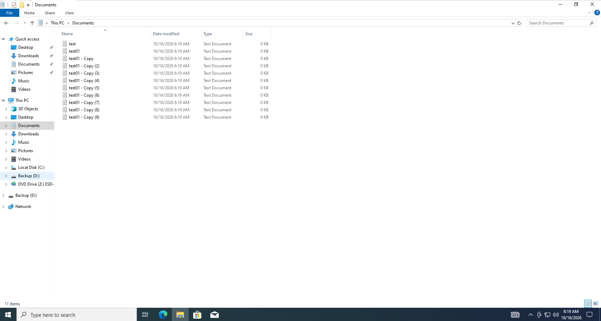

**Lệnh sao lưu:**
```cmd
robocopy C:\Users\user01\Documents D:\Backup\Documents /E /LOG:D:\Backup\Backup.log
echo %errorlevel%
```
> Kết quả `%errorlevel% = 1` → robocopy báo thành công (đã sao chép ít nhất 1 file).

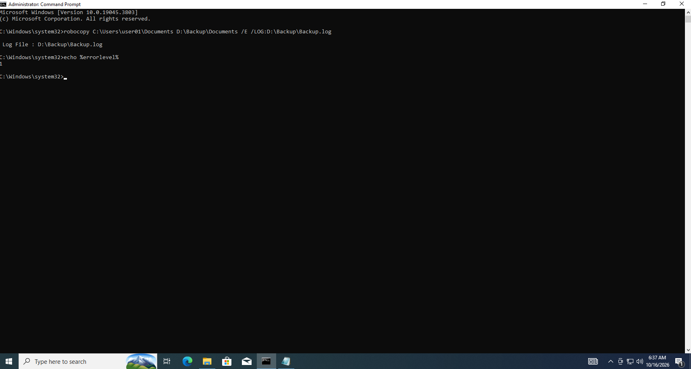

**Kiểm tra hệ thống file trước khi khôi phục:**
```cmd
sfc /scannow
```
> Kết quả: *"Windows Resource Protection found corrupt files and successfully repaired them."* – SFC tìm và tự sửa được lỗi file hệ thống.

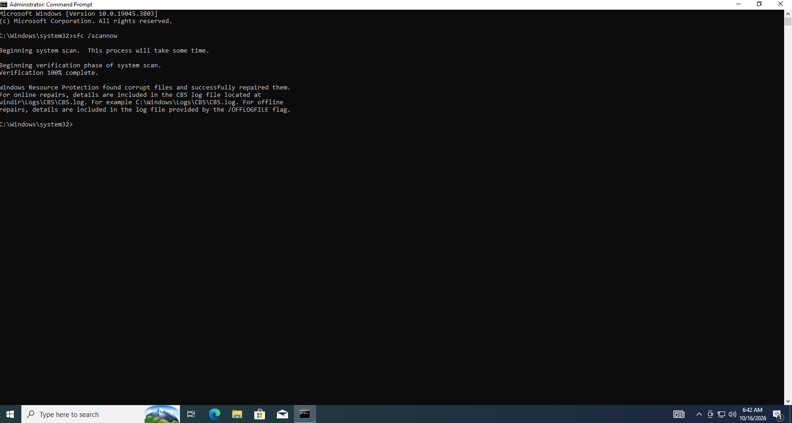

**Lệnh khôi phục:**
```cmd
robocopy D:\Backup\Documents C:\Users\user01\Documents /E
```
> Kết quả: 11 file từ backup được sao chép trở lại Documents thành công (17 files, 11 copied, 6 skipped).

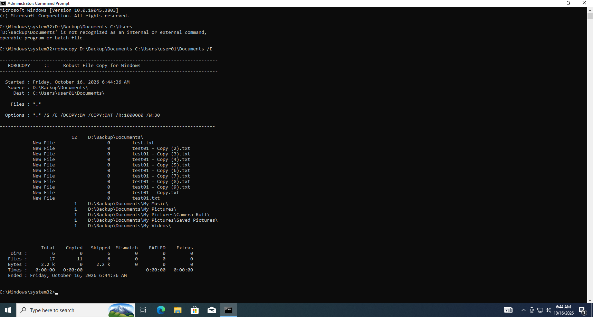

---

## Danh sách sự cố đã xử lý

*(Chưa có – sẽ cập nhật sau khi hoàn thành phần ticket)*

| Mã | Sự cố | Ưu tiên | Trạng thái |
|---|---|---|---|
| – | – | – | – |

---

## Bài học rút ra

- Luôn tạo snapshot trước khi thực hiện bất kỳ thay đổi quan trọng nào (cài phần mềm, chỉnh cấu hình, test sự cố) – rollback nhanh hơn nhiều so với cài lại từ đầu.
- Kiểm tra `%errorlevel%` sau robocopy rất quan trọng: giá trị 0 là không có gì thay đổi, 1 là sao chép thành công, từ 8 trở lên mới là lỗi thực sự.
- Nên chạy `sfc /scannow` sau mỗi lần cài phần mềm lớn hoặc khi hệ thống có dấu hiệu bất thường để phát hiện file hệ thống bị hỏng sớm.
