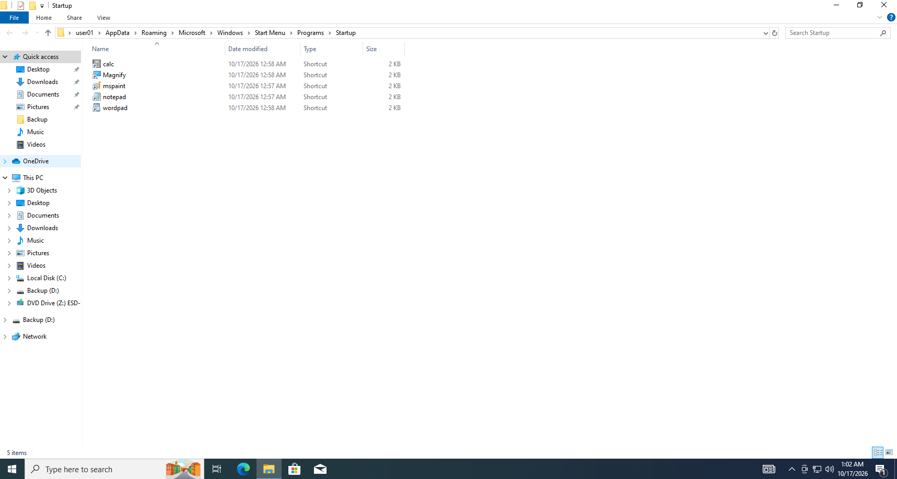
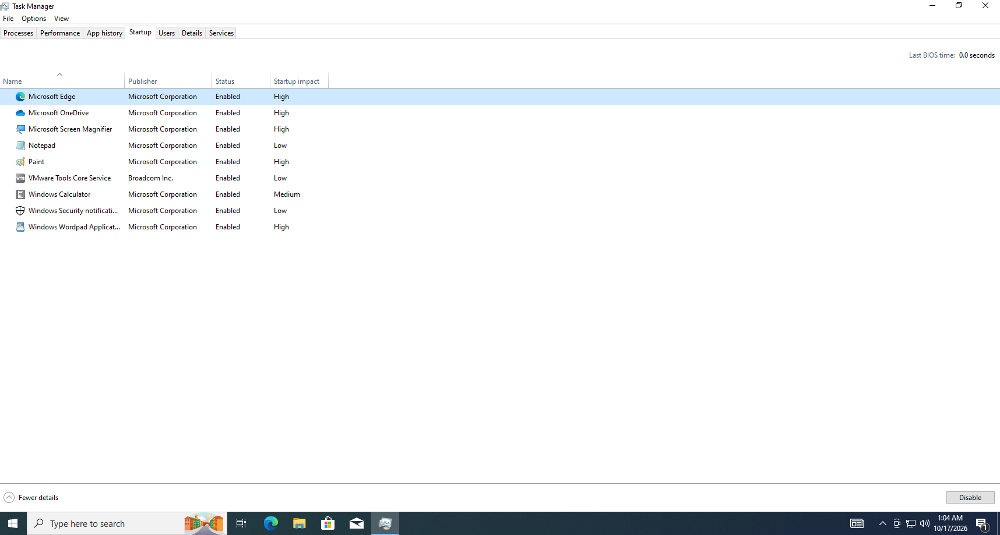
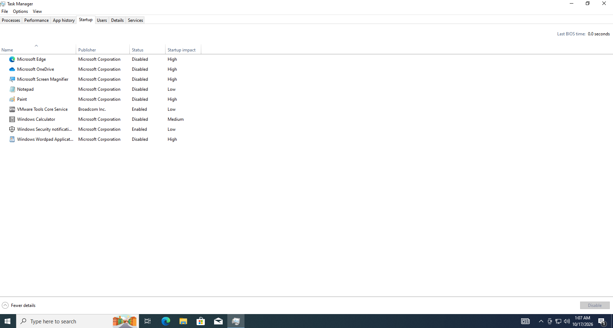

# T001 – Máy khởi động chậm

## Thông tin ticket

| Trường | Nội dung |
|---|---|
| **Mã ticket** | T001 |
| **Ngày tiếp nhận** | 2026-10-17 |
| **Người dùng báo** | user01 |
| **Ưu tiên** | Thấp |
| **Trạng thái** | Đã xử lý ✅ |

---

## Mô tả sự cố

> "Máy khởi động chậm" – người dùng phản ánh máy mất nhiều thời gian để vào được desktop sau khi bật nguồn.

---

## Triệu chứng quan sát được

Mở thư mục Startup (`shell:startup`) phát hiện 5 shortcut ứng dụng không cần thiết được thêm vào:
- calc, Magnify, mspaint, notepad, wordpad

Kiểm tra Task Manager → tab **Startup** thấy **9 mục**, trong đó có 5 mục ứng dụng thêm vào với Startup impact = **High**.

---

## Chẩn đoán

- **Nguyên nhân:** 5 shortcut ứng dụng không cần thiết (Calculator, Magnifier, Paint, Notepad, WordPad) được tạo trong thư mục `shell:startup` của user01
- **Hậu quả:** Mỗi lần boot, Windows phải khởi động thêm 5 ứng dụng này → kéo dài thời gian vào desktop
- **Xác nhận:** Task Manager → Startup tab hiển thị các mục trên với Status = **Enabled** và Startup impact = **High**

---

## Bước xử lý

**Bước 1 – Disable trong Task Manager:**
- Mở Task Manager (`Ctrl+Shift+Esc`) → tab **Startup**
- Chuột phải từng mục thêm vào → **Disable**
- Các mục đã Disable: Microsoft Edge, Microsoft Screen Magnifier, Paint, Windows Calculator, Windows Wordpad Application, Notepad

**Bước 2 – Xóa shortcut trong shell:startup:**
- Mở `Win + R` → `shell:startup`
- Chọn tất cả 5 shortcut → Delete

---

## Kết quả

| | Trước | Sau |
|---|---|---|
| Tổng mục Startup | 9 mục | 9 mục (giữ nguyên số lượng) |
| Mục Enabled | 9 | 2 (VMware Tools Core Service, Windows Security notification) |
| Mục Disabled | 0 | 7 |
| Mục High impact đang Enabled | 5 | 0 |

---

## Ghi chú

- Cột **Startup impact** vẫn hiển thị "High" sau khi Disable là **bình thường** – Windows chỉ đo lại sau lần khởi động tiếp theo; giá trị đó phản ánh lần boot trước, không ảnh hưởng đến kết quả xử lý.
- Không khẳng định máy "nhanh hơn" vì chưa đo thực tế thời gian boot trước và sau.
- Khuyến nghị người dùng không tạo shortcut trong `shell:startup` trừ khi thực sự cần ứng dụng đó chạy ngay khi khởi động.
- Các mục được giữ lại (Enabled): **VMware Tools Core Service** (cần thiết cho máy ảo) và **Windows Security notification** (cần thiết cho bảo mật).
