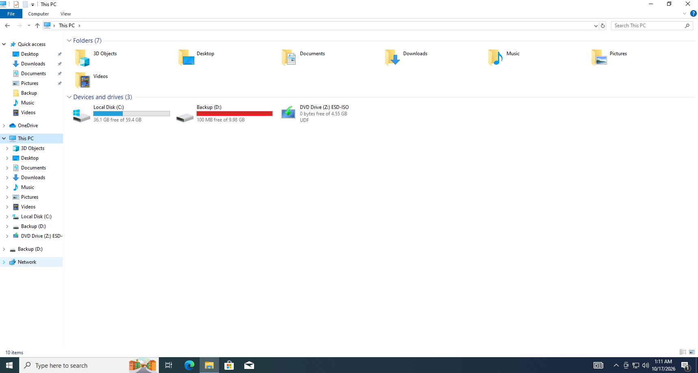
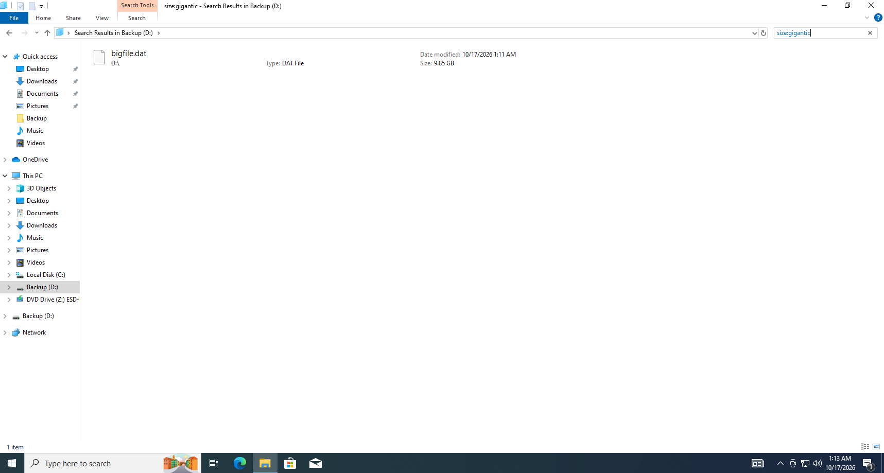
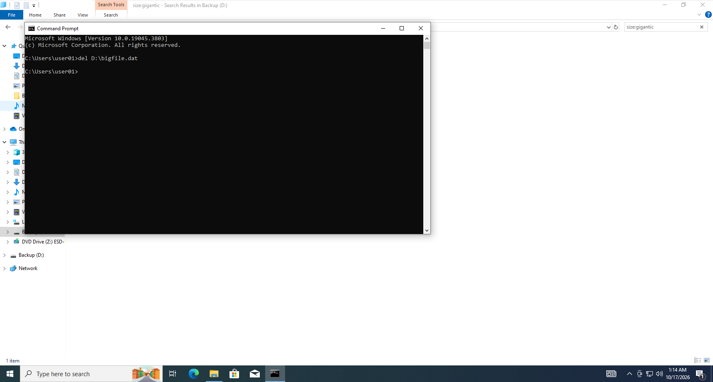
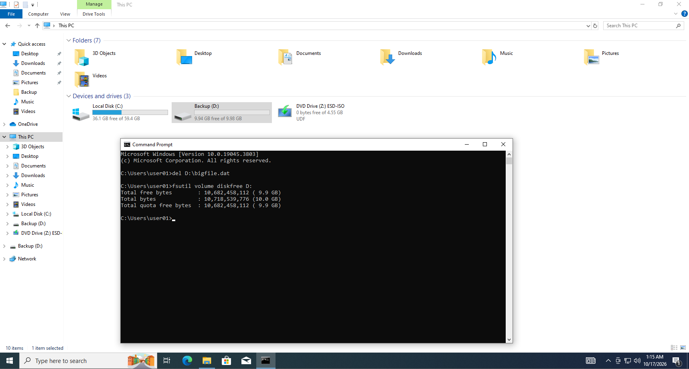

# T002 – Ổ D báo đầy, không lưu được file

## Thông tin ticket

| Trường | Nội dung |
|---|---|
| **Mã ticket** | T002 |
| **Ngày tiếp nhận** | 2026-10-17 |
| **Người dùng báo** | user01 |
| **Ưu tiên** | Cao |
| **Trạng thái** | Đã xử lý ✅ |

---

## Mô tả sự cố

> "Ổ D báo đầy, không lưu được file" – người dùng không thể lưu thêm dữ liệu vào ổ D, thanh ổ đĩa hiển thị màu đỏ trong File Explorer.

---

## Triệu chứng quan sát được

Mở **This PC** trong File Explorer, ổ **Backup (D:)** hiển thị thanh màu **đỏ** với chỉ còn **100 MB free of 9.98 GB** – gần như đầy hoàn toàn.



---

## Chẩn đoán

Mở ổ D trong Explorer → tìm kiếm `size:gigantic` ở ô Search → phát hiện file **`bigfile.dat`** tại `D:\` với kích thước **9.85 GB** – chiếm gần toàn bộ dung lượng ổ.



**Kết luận:** File `D:\bigfile.dat` không phải file hệ thống hay dữ liệu người dùng – đây là file dư thừa chiếm toàn bộ dung lượng ổ D.

---

## Bước xử lý

Mở **CMD**, chạy lệnh xóa file:

```cmd
del D:\bigfile.dat
```

Lệnh hoàn thành không có thông báo lỗi → file đã được xóa thành công.



---

## Kết quả

Sau khi xóa, chạy xác nhận dung lượng:

```cmd
fsutil volume diskfree D:
```

| | Trước | Sau |
|---|---|---|
| **Dung lượng trống** | ~100 MB (9.85 GB bị chiếm) | **10,682,458,112 bytes (~9.9 GB)** |
| **Tổng dung lượng** | 9.98 GB | 9.98 GB |
| **Thanh ổ đĩa** | 🔴 Đỏ | ⚪ Bình thường |



---

## Ghi chú

- File `bigfile.dat` là file giả lập sự cố – trong thực tế có thể là file tạm, file dump, file cache hoặc file tải về không xóa.
- Công cụ tìm file lớn: Explorer `size:gigantic` (> 128 MB) là cách nhanh nhất để phát hiện nguyên nhân đầy ổ.
- Ngoài ra có thể dùng **Settings → System → Storage** để xem phân bổ dung lượng theo loại file.
- Khuyến nghị người dùng định kỳ kiểm tra ổ D và dọn file tạm bằng **Disk Cleanup**.
