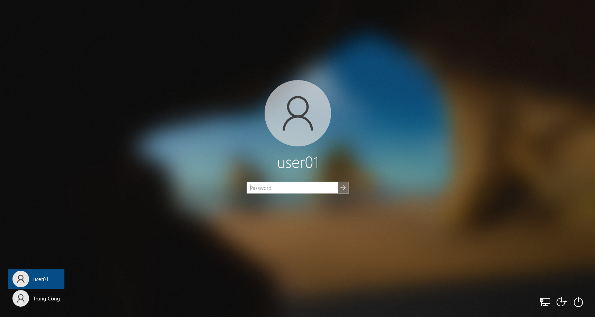
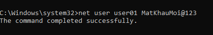
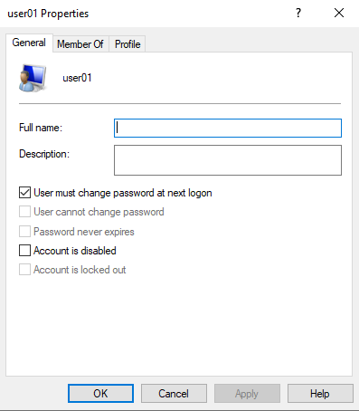
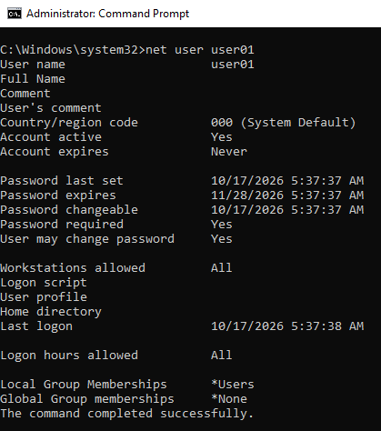

# T003 – Quên mật khẩu

## Thông tin ticket

| Trường | Nội dung |
|---|---|
| **Mã ticket** | T003 |
| **Ngày tiếp nhận** | 2026-10-17 |
| **Người dùng báo** | user01 |
| **Ưu tiên** | Trung bình |
| **Trạng thái** | Đã xử lý ✅ |

---

## Mô tả sự cố

> "Em quên mật khẩu" – người dùng user01 không thể đăng nhập vào máy vì không nhớ mật khẩu.

---

## Triệu chứng quan sát được

Màn hình đăng nhập Windows hiển thị tài khoản **user01** với ô **Password** trống – người dùng không thể nhập đúng mật khẩu để vào máy.



---

## Chẩn đoán

- Người dùng quên mật khẩu tài khoản cục bộ **user01**
- Không có tùy chọn "Forgot password" cho tài khoản local trong môi trường này
- **Giải pháp:** IT đăng nhập bằng tài khoản admin (**Trung Công**) → reset mật khẩu cho user01 qua `net user`

---

## Bước xử lý

**Bước 1 – Đăng nhập tài khoản admin:**
- Tại màn hình đăng nhập → chọn tài khoản **Trung Công** (admin) → nhập mật khẩu admin → vào được desktop

**Bước 2 – Reset mật khẩu user01:**

Mở **CMD** (Administrator), chạy:

```cmd
net user user01 MatKhauMoi@123
```

Kết quả: `The command completed successfully.`



**Bước 3 – Yêu cầu user01 tự đổi mật khẩu khi đăng nhập:**

Mở `lusrmgr.msc` → **Users** → **user01** → **Properties**:
- Tick **"User must change password at next logon"** ✅
- **Apply** → **OK**



---

## Kết quả

Xác nhận thông tin tài khoản user01 sau khi reset:

```cmd
net user user01
```

- **Password last set:** 10/17/2026 5:37:37 AM → mật khẩu mới đã được đặt thành công
- **Password required:** Yes
- **User may change password:** Yes
- **Account active:** Yes – tài khoản hoạt động bình thường



---

## Ghi chú

- Mật khẩu tạm thời **MatKhauMoi@123** được thông báo trực tiếp cho người dùng
- Tick **"User must change password at next logon"** đảm bảo user01 tự đặt mật khẩu riêng ngay lần đăng nhập đầu tiên – IT sẽ không biết mật khẩu thực của người dùng sau đó (best practice bảo mật)
- Với tài khoản domain (Active Directory), nên dùng **Active Directory Users and Computers** thay vì `net user`
