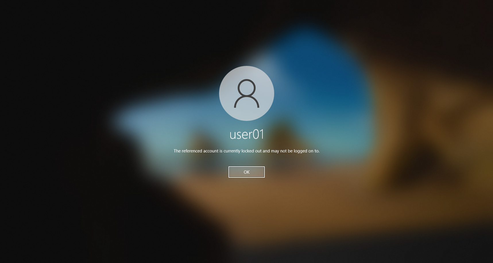
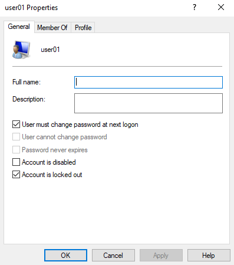
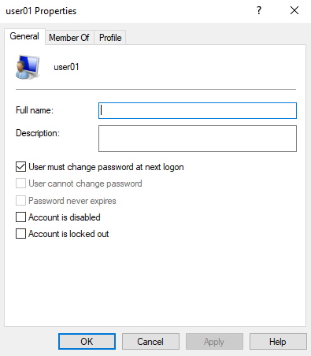
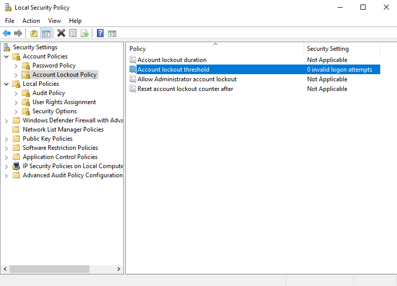
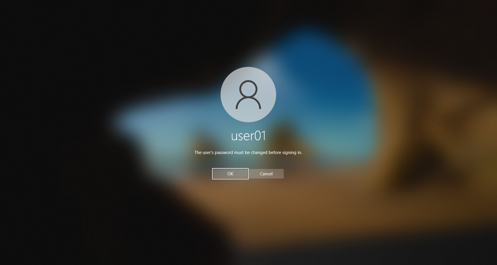

# T004 – Tài khoản bị khóa

## Thông tin ticket

| Trường | Nội dung |
|---|---|
| **Mã ticket** | T004 |
| **Ngày tiếp nhận** | 2026-10-17 |
| **Người dùng báo** | user01 |
| **Ưu tiên** | Cao |
| **Trạng thái** | Đã xử lý ✅ |

---

## Mô tả sự cố

> "Tài khoản bị khóa" – người dùng user01 đăng nhập sai mật khẩu nhiều lần, hệ thống tự động khóa tài khoản và không cho đăng nhập.

---

## Triệu chứng quan sát được

Màn hình đăng nhập Windows hiển thị thông báo:

> **"The referenced account is currently locked out and may not be logged on to."**

Người dùng không thể đăng nhập dù nhập đúng mật khẩu sau đó.

---

## Chẩn đoán

Đăng nhập tài khoản admin (**Trung Công**) → mở `lusrmgr.msc` → **Users** → **user01** → **Properties**.

Quan sát: checkbox **"Account is locked out"** đang được **tick ✅** → xác nhận tài khoản bị khóa do nhập sai mật khẩu quá số lần cho phép theo Account Lockout Policy.

---

## Bước xử lý

**Bước 1 – Mở khóa tài khoản user01:**

Trong **Properties** của user01 (`lusrmgr.msc`):
- **Bỏ tick** checkbox **"Account is locked out"**
- Nhấn **Apply** → **OK**

**Bước 2 – Trả Account Lockout Policy về mặc định:**

Mở `secpol.msc` → **Account Policies** → **Account Lockout Policy**:
- Đặt **Account lockout threshold** = `0` → các mục còn lại tự về **Not Applicable**

---

## Kết quả

**Xác nhận:** Đăng xuất → đăng nhập lại bằng tài khoản **user01** → Windows hiển thị thông báo:

> **"The user's password must be changed before signing in."**

Điều này xác nhận:
- Tài khoản user01 đã được **mở khóa thành công** ✅
- Người dùng được yêu cầu tự đặt mật khẩu mới theo policy đã thiết lập trước đó

---

## Ghi chú

- **Nguyên nhân khóa:** Account Lockout Policy được cấu hình với threshold = 3 lần sai → user01 nhập sai 3 lần liên tiếp → bị khóa tự động.
- **Sau khi xử lý:** Policy đã được trả về mặc định (threshold = 0 = disabled) để tránh ảnh hưởng đến môi trường lab.
- **Lưu ý thực tế:** Trong môi trường doanh nghiệp, nên giữ Account Lockout Policy (threshold 5–10 lần) để bảo vệ chống brute-force, nhưng cần có quy trình mở khóa rõ ràng cho IT support.
- Thông báo **"locked out"** khác với **"wrong password"** – giúp IT xác định đúng nguyên nhân để xử lý đúng cách.
