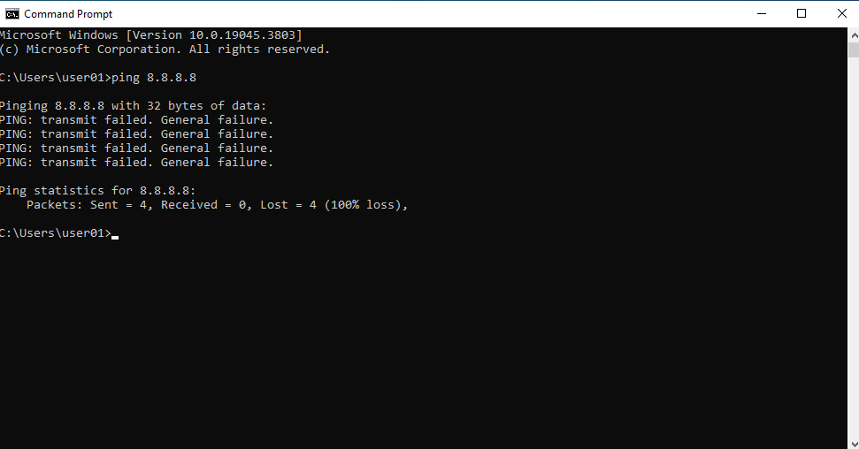
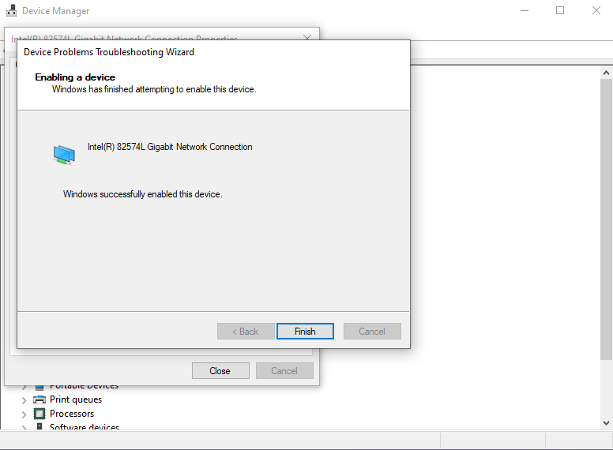
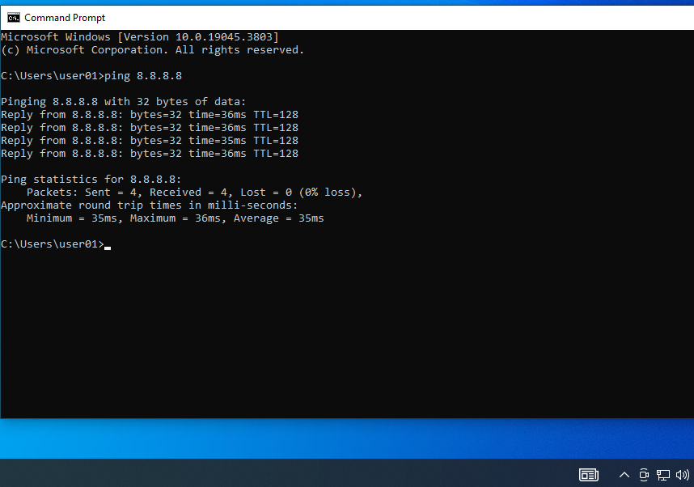

# T005 – Mạng mất kết nối

## Thông tin ticket

| Trường | Nội dung |
|---|---|
| **Mã ticket** | T005 |
| **Ngày tiếp nhận** | 2026-10-17 |
| **Người dùng báo** | user01 |
| **Ưu tiên** | Cao |
| **Trạng thái** | Đã xử lý ✅ |

---

## Mô tả sự cố

> "Mạng mất kết nối" – người dùng không thể truy cập internet, biểu tượng mạng trên thanh taskbar hiển thị dấu hiệu bất thường.

---

## Triệu chứng quan sát được

Biểu tượng mạng ở **System Tray** (góc phải taskbar) hiển thị **biểu tượng địa cầu** thay vì biểu tượng mạng bình thường – dấu hiệu không có kết nối mạng.


---

## Chẩn đoán

Mở **CMD**, chạy lệnh kiểm tra kết nối:

```cmd
ping 8.8.8.8
```

Kết quả:
```
PING: transmit failed. General failure.
Packets: Sent = 4, Received = 0, Lost = 4 (100% loss)
```

→ Xác nhận hoàn toàn mất kết nối mạng ở tầng network adapter.



**Kiểm tra Device Manager (`Win + X → Device Manager`):**
- Mở rộng **Network adapters**
- Card **Intel(R) 82574L Gigabit Network Connection** hiển thị mũi tên ↓ xám = bị **Disabled** thủ công

**Kết luận:** Card mạng bị tắt trong Device Manager → không có kết nối mạng.

---

## Bước xử lý

Trong **Device Manager** → **Network adapters**:
- Chuột phải **Intel(R) 82574L Gigabit Network Connection** → **Enable device**
- Windows hiển thị wizard **"Enabling a device"** → **"Windows successfully enabled this device."**
- Nhấn **Finish**



---

## Kết quả

Chạy lại lệnh kiểm tra kết nối:

```cmd
ping 8.8.8.8
```

Kết quả:
```
Reply from 8.8.8.8: bytes=32 time=36ms TTL=128
Reply from 8.8.8.8: bytes=32 time=36ms TTL=128
Reply from 8.8.8.8: bytes=32 time=35ms TTL=128
Reply from 8.8.8.8: bytes=32 time=36ms TTL=128
Packets: Sent = 4, Received = 4, Lost = 0 (0% loss)
```

→ Kết nối mạng **đã phục hồi hoàn toàn**, latency ổn định ~35ms.



---

## Ghi chú

- Card mạng: **Intel(R) 82574L Gigabit Network Connection** (card mạng ảo của VMware)
- Nguyên nhân: card mạng bị **Disable** thủ công trong Device Manager → Windows không có giao diện mạng nào để gửi gói tin
- Phân biệt với dấu `!` vàng trong Device Manager = driver lỗi (cần cài lại driver, khác nguyên nhân)
- Phân biệt với dấu `↓` xám = disabled thủ công (chỉ cần Enable lại)
- Ngoài Device Manager, có thể kiểm tra nhanh qua: `ncpa.cpl` → thấy card mạng màu xám = disabled
