# Lab 02: Office – Cài đặt, cấu hình và xử lý sự cố

## Mục tiêu

Cài và cấu hình Microsoft Office trên máy ảo, thực hành Outlook / Excel / Word,
tự tạo và xử lý các sự cố Office thường gặp trong môi trường hỗ trợ kỹ thuật.

---

## Môi trường

| Thành phần | Chi tiết |
|---|---|
| Hypervisor | VMware Workstation (từ Lab 1) |
| Hệ điều hành | Windows 10 Pro (snapshot `02-Ready-for-Tickets` của Lab 1) |
| Microsoft Office | **Microsoft 365 Apps for enterprise** – Version 2609, Build 16.0.20430.20032, 64-bit, Current Channel |
| Tài khoản email thử | Outlook.com (tạo riêng cho lab, không dùng email thật) |

> **Ghi chú bản quyền:** Bộ cài được tải từ trang tài khoản Microsoft (account.microsoft.com).  
> Đây là gói **Microsoft 365 subscription** – cho phép cài trên nhiều thiết bị theo gói đăng ký.  
> Email tài khoản Microsoft và key sản phẩm đã được che trong tất cả ảnh chụp màn hình.

---

## Cấu trúc thư mục

```
02-office/
├── images/          # Ảnh chụp màn hình các bước thực hiện và ticket
├── samples/         # File dữ liệu mẫu (toàn bộ dữ liệu giả)
│   ├── BangLuong-Thu.xlsx
│   ├── ThongBaoNoiBo.docx
│   ├── ThongBaoNoiBo.pdf
│   └── ThuMoi-MailMerge.docx
├── tickets/         # Ticket sự cố (sẽ bổ sung sau)
└── README.md
```

---

## Các bước thực hiện

### Giai đoạn 1 – Cài đặt Office

**Nguồn cài:** Đăng nhập tài khoản Microsoft tại `account.microsoft.com` → Mục dịch vụ/đăng ký → tải bộ cài Office → chạy installer. Thời gian cài khoảng 20 phút (tùy tốc độ mạng).

| Bước | Mô tả | Ảnh |
|---|---|---|
| 01 | Word → File → Account: xác nhận sản phẩm là Microsoft 365 Apps for enterprise, email đã che | 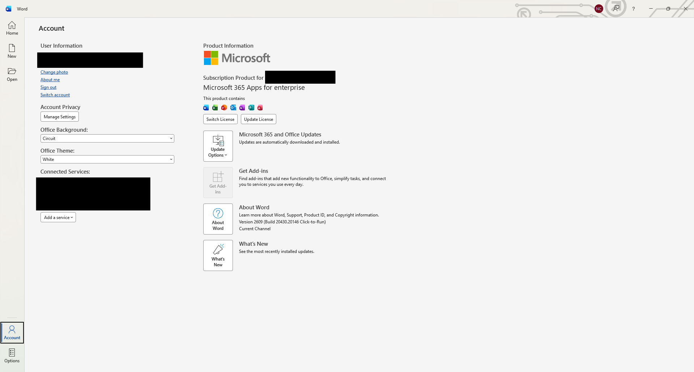 |
| 02 | File → Account → Update Options → Update Now: kết quả "You're up to date!" | 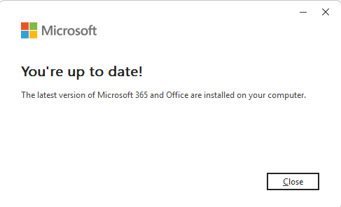 |
| 03 | File → Account → About Word: **Version 2609 (Build 16.0.20430.20032) 64-bit, Current Channel** | 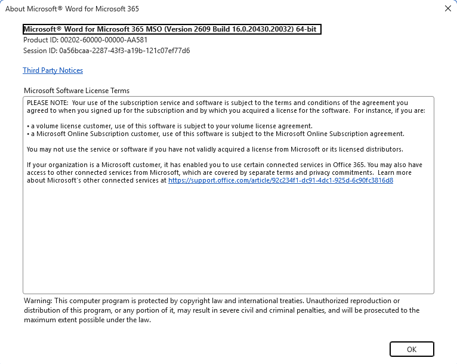 |
| 04 | Snapshot `03-Office-Installed` *(không chụp ảnh riêng – snapshot được tạo trực tiếp trong VMware)* | — |

---

### Giai đoạn 2 – Cấu hình Outlook

> **Lưu ý phiên bản:** Office 365 Apps cài về là **New Outlook** (giao diện mới).  
> Một số tính năng của Outlook classic như `Account Settings` kiểu MAPI và lệnh `outlook.exe /safe`  
> không áp dụng được với New Outlook. Các bước dưới đây ghi đúng thực tế với New Outlook.

Tài khoản email thử dùng trong lab là địa chỉ **Outlook.com** tạo riêng, không dùng email thật.

| Bước | Mô tả | Ảnh |
|---|---|---|
| 05 | Outlook → Add account: nhập email Outlook.com thử, đăng nhập thành công | 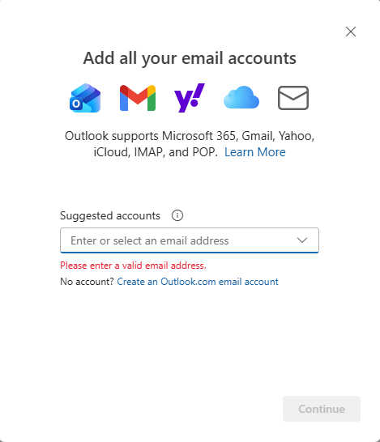 |
| 06 | Gửi mail tới chính tài khoản đó, nhận mail thành công (tiêu đề và địa chỉ đã che) |  |
| 07 | Settings → Compose and reply → Email signature: tạo chữ ký "Nguyễn Công Trung" | 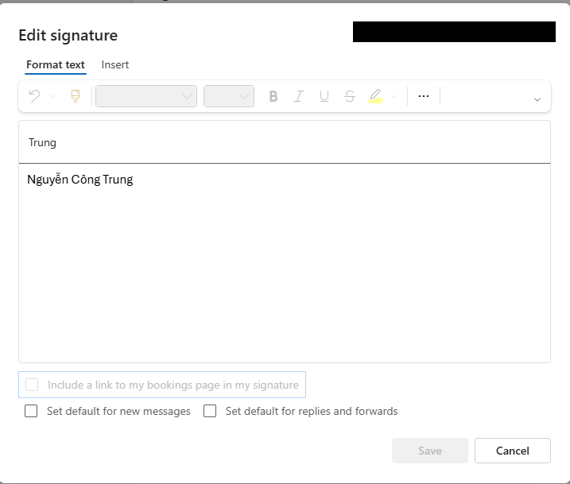 |
| 08 | Settings → Rules → New rule "BAOCAO": nếu subject chứa "BAOCAO" thì chuyển vào folder "BAOCAO" | 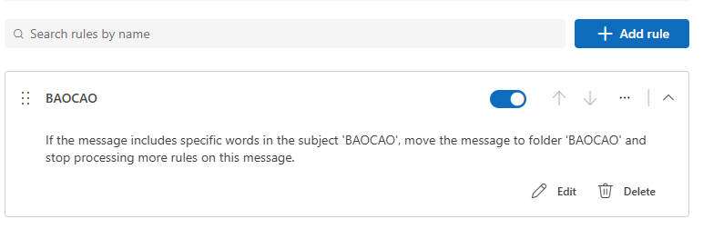 |

---

### Giai đoạn 3 – Excel

File làm việc: [`samples/BangLuong-Thu.xlsx`](samples/BangLuong-Thu.xlsx)  
Dữ liệu: 15 nhân viên giả (Mã NV, Họ tên giả, Phòng ban, Lương giả, Ngày vào làm, Xếp loại).

| Bước | Nội dung | Ảnh |
|---|---|---|
| 09 | **SUM · AVERAGE · IF:** Tổng lương = 241,000,000 · Lương TB ≈ 16,066,667 · Cột Xếp loại dùng `IF(D>15000000,"Cao","Thường")` | 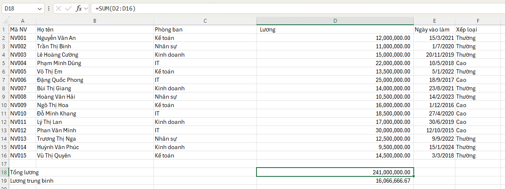 |
| 10 | **VLOOKUP + XLOOKUP:** Sheet TraCuu tra theo Mã NV, dùng `VLOOKUP` (Họ tên, Lương) và `XLOOKUP` (Phòng ban). Ví dụ: NV003 → Lê Hoàng Cường, 15,000,000, Kinh doanh | 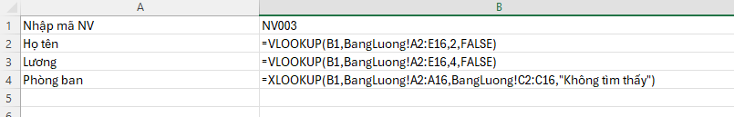 |
| 11 | **Filter + Conditional Formatting:** Lọc phòng ban IT, tô màu đỏ nhạt ô lương cao nhất | 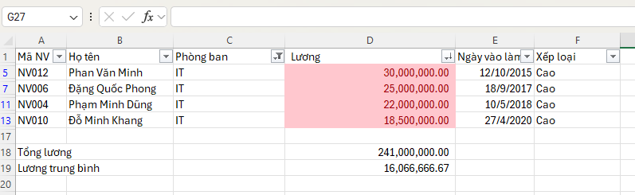 |
| 12 | **PivotTable** tổng lương theo phòng ban: IT 95.5M · Kế toán 56M · Kinh doanh 55.5M · Nhân sự 34M · Grand Total 241M | 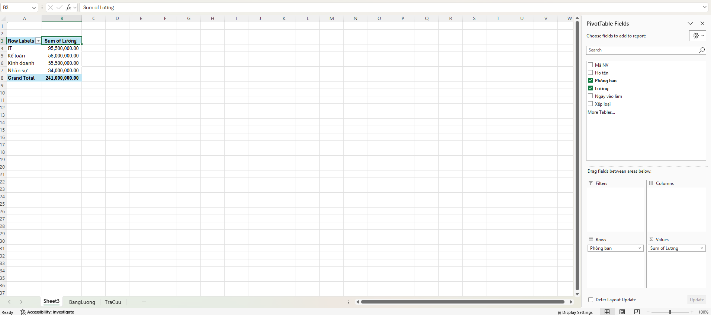 |

---

### Giai đoạn 4 – Word

Files làm việc: [`samples/ThongBaoNoiBo.docx`](samples/ThongBaoNoiBo.docx) · [`samples/ThuMoi-MailMerge.docx`](samples/ThuMoi-MailMerge.docx)

| Bước | Nội dung | Ảnh |
|---|---|---|
| 13 | **Styles + Mục lục + Đánh số trang:** Văn bản "THÔNG BÁO NỘI BỘ – Quy trình hỗ trợ kỹ thuật 2026", dùng Heading 1/2, mục lục tự động tạo bằng References → Table of Contents, số trang ở footer | 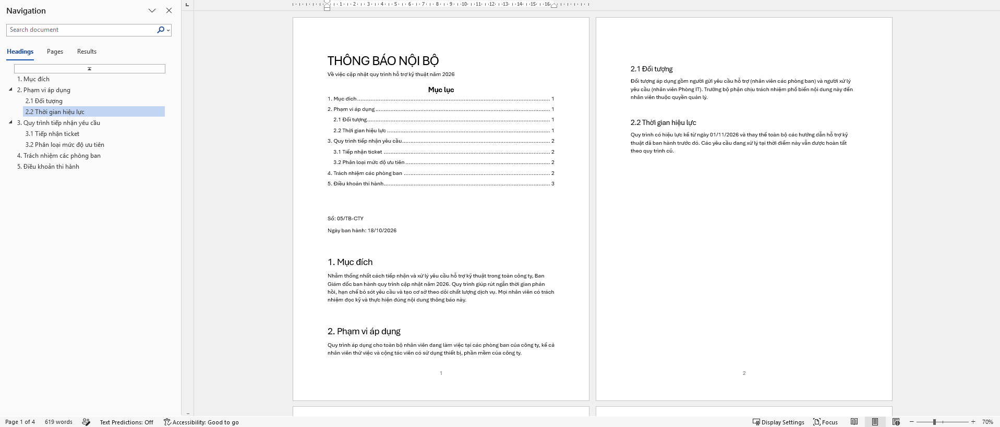 |
| 14 | **Mail Merge:** Mailings → Start Mail Merge → Select Recipients từ `BangLuong-Thu.xlsx`, chèn trường «Họ tên» / «Mã NV» / «Phòng ban», Preview bản ghi NV004 – Phạm Minh Dũng | 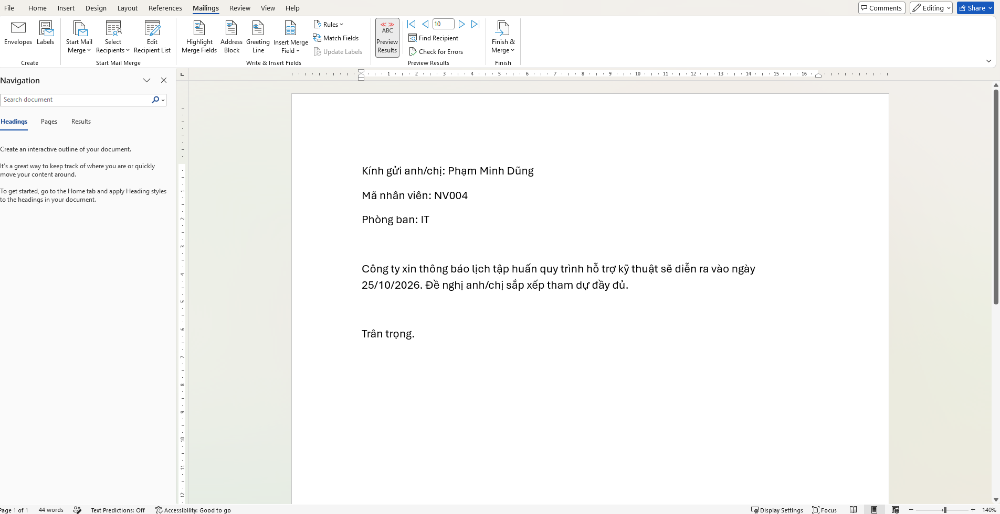 |
| 15 | **Xuất PDF:** File → Export → Create PDF/XPS, kết quả [`ThongBaoNoiBo.pdf`](samples/ThongBaoNoiBo.pdf) (4 trang) | 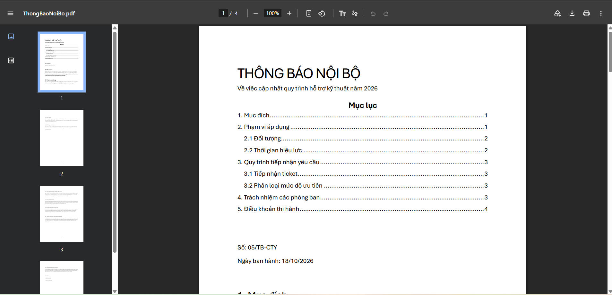 |

---

## Danh sách sự cố đã xử lý

> ⏳ **Chưa thực hiện – sẽ bổ sung sau khi hoàn thành Giai đoạn 5.**

| Mã | Sự cố | Ưu tiên | Trạng thái |
|---|---|---|---|
| O001 | Outlook không gửi/nhận được mail | Cao | 🔲 Chưa làm |
| O002 | Word đơ, mất file chưa lưu | Trung bình | 🔲 Chưa làm |
| O003 | File Excel mở chỉ đọc do Protected View | Trung bình | 🔲 Chưa làm |
| O004 | Công thức báo lỗi #N/A, #REF!, #DIV/0! | Trung bình | 🔲 Chưa làm |
| O005 | Cột số không cộng được, tổng ra 0 | Thấp | 🔲 Chưa làm |

---

## Quy trình tham khảo (chưa gặp sự cố thật)

Các thao tác dưới đây đã được thực hiện để nắm quy trình, **nhưng không có sự cố thật nào xảy ra** nên không ghi thành ticket:

- **Quick Repair / Online Repair Office:**  
  Settings → Apps → Microsoft 365 Apps → Modify → chọn Quick Repair (không cần Internet) hoặc  
  Online Repair (kết nối Internet, toàn diện hơn). Dùng khi Office crash, thiếu tính năng, hoặc lỗi cài đặt.

- **Mở Outlook ở Safe Mode:**  
  Với **New Outlook**, lệnh `outlook.exe /safe` chỉ dành cho Outlook classic – không áp dụng.  
  Với New Outlook, nếu có lỗi add-in, tắt add-in trong Settings → Add-ins.

---

## Bài học rút ra

- Microsoft 365 Apps for enterprise là gói subscription – Office luôn tự cập nhật lên phiên bản mới nhất qua Current Channel, khác với bản mua một lần (Office 2019/2021) cố định build. Khi hỗ trợ người dùng cần hỏi rõ họ dùng gói nào để biết build chính xác.
- New Outlook thay đổi vị trí nhiều cài đặt so với Outlook classic (Account Settings, Safe Mode, Rules); cần xác định phiên bản Outlook trước khi hướng dẫn người dùng.
- Protected View trong Office là cơ chế bảo mật dựa trên `Zone.Identifier` – tệp tải từ Internet bị đánh dấu ZoneId=3 và mở ở chế độ chỉ đọc; hiểu cơ chế này giúp giải thích đúng nguyên nhân cho người dùng thay vì chỉ bảo "bấm Enable Editing".

