# Lab 03: Máy in – Print server và xử lý sự cố in ấn

## Mục tiêu

Dựng print server trên máy ảo, chia sẻ máy in giả lập qua mạng nội bộ,
in thử từ máy người dùng, tự tạo và xử lý các sự cố in ấn thường gặp.

---

## Môi trường

| Thành phần | Chi tiết |
|---|---|
| Hypervisor | VMware Workstation (clone từ Lab 1) |
| Hệ điều hành | Windows 10 Pro (clone từ snapshot `02-Ready-for-Tickets` của Lab 1) |
| Máy A | **PRINT-SRV-01** – 192.168.50.10 – print server |
| Máy B | **PC-USER-02** – 192.168.50.20 – máy người dùng |
| Máy in | **Máy in giả lập** – driver Generic / Text Only, cổng `C:\PrintOut\output.txt`, tên chia sẻ `PRN-LAB-01` |
| Mạng | VMware Host-only (hai máy thấy nhau, không ra Internet) |

> **Lưu ý:** Máy in trong lab này là máy in **giả lập** ghi ra file, không phải máy in vật lý.
> Toàn bộ phần chia sẻ, phân quyền và hàng đợi in vẫn là thật.

---

## Cấu trúc thư mục

```
03-printer/
├── images/     # Ảnh chụp màn hình các bước thực hiện và ticket
├── tickets/    # Ticket sự cố (sẽ bổ sung sau)
└── README.md
```

---

## Các bước thực hiện

### Giai đoạn 1 – Dựng hai máy ảo và mạng

| Bước | Mô tả | Ảnh |
|---|---|---|
| 01 | VMware Workstation → Clone từ snapshot `02-Ready-for-Tickets`, tạo hai linked clone: `LAB3-PrintServer` và `LAB3-Client` | 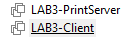 |
| 02 | VM Settings → Network Adapter → **Host-only** trên cả hai máy |  |
| 03 | Đổi tên máy A thành `PRINT-SRV-01`, máy B thành `PC-USER-02` bằng `Rename-Computer` trong PowerShell Admin, sau đó khởi động lại | — |
| 04A | Đặt IP tĩnh máy A: **192.168.50.10**, subnet 255.255.255.0; kết quả kiểm tra bằng `ipconfig` | 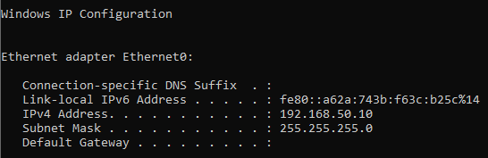 |
| 04B | Đặt IP tĩnh máy B: **192.168.50.20**, subnet 255.255.255.0; kết quả kiểm tra bằng `ipconfig` | 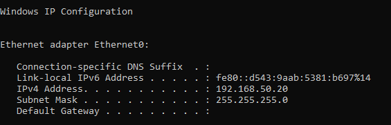 |
| 05 | Đặt mạng thành **Private** trên cả hai máy bằng `Set-NetConnectionProfile` trong PowerShell Admin (không có Internet nên Windows mặc định đánh dấu Public và chặn chia sẻ) | 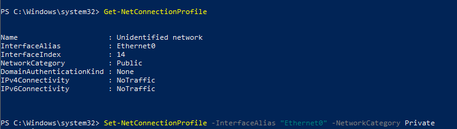 |
| 06 | Kiểm tra thông mạng từ máy B: `ping 192.168.50.10` – kết quả 4/4 packets nhận được, 0% loss | 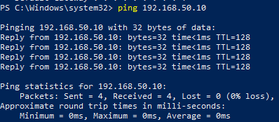 |

**Lệnh đổi tên máy (PowerShell Admin):**
```powershell
# Trên máy A
Rename-Computer -NewName PRINT-SRV-01 -Restart

# Trên máy B
Rename-Computer -NewName PC-USER-02 -Restart
```

**Lệnh đặt mạng Private (PowerShell Admin – chạy trên cả hai máy):**
```powershell
Get-NetConnectionProfile
Set-NetConnectionProfile -InterfaceAlias "Ethernet0" -NetworkCategory Private
```

---

### Giai đoạn 2 – Tạo máy in và chia sẻ trên máy A

| Bước | Mô tả | Ảnh |
|---|---|---|
| 07 | Tạo tài khoản `printuser` cho máy B đăng nhập vào server | 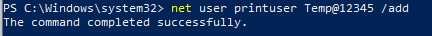 |
| 08 | Settings → Devices → Printers & scanners → Add a printer → The printer that I want isn't listed → Add a local printer → **Create a new port** → Local Port → nhập tên cổng `C:\PrintOut\output.txt` | 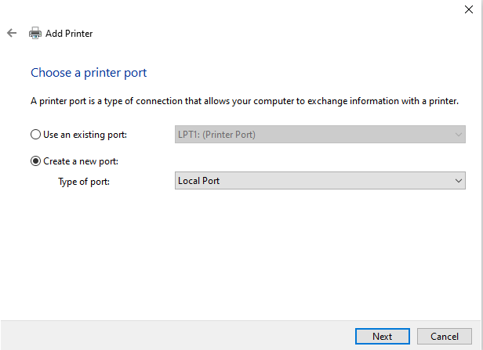 |
| 09 | Chọn hãng **Generic**, máy in **Generic / Text Only** | 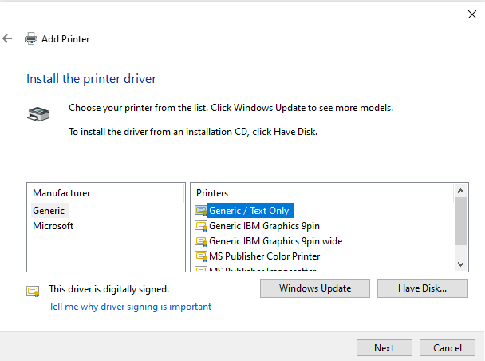 |
| 10 | Đặt tên `PRN-LAB-01`, bật **Share this printer**, tên chia sẻ `PRN-LAB-01` | 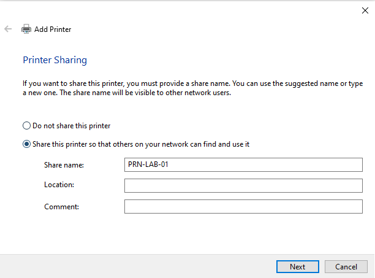 |
| 11 | Control Panel → Network and Sharing Center → Change advanced sharing settings → Private → **Turn on file and printer sharing** | 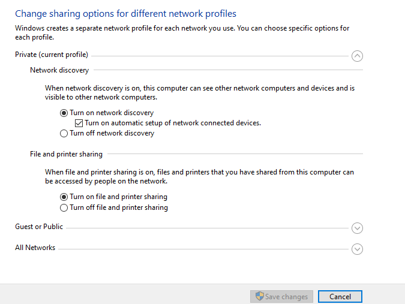 |
| 12 | Windows Defender Firewall → Allow an app → xác nhận **File and Printer Sharing** được bật cho mạng Private | 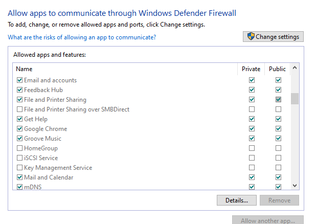 |

**Lệnh tạo thư mục nhận bản in (Command Prompt Admin trên máy A):**
```cmd
mkdir C:\PrintOut
```

**Lệnh tạo tài khoản (Command Prompt Admin trên máy A):**
```cmd
net user printuser Temp@12345 /add
```

---

### Giai đoạn 3 – Kết nối và in thử từ máy B

| Bước | Mô tả | Ảnh |
|---|---|---|
| 13 | Máy B: `Win + R` → `\\192.168.50.10` → đăng nhập `printuser / Temp@12345` → thấy máy in `prn-lab-01` | 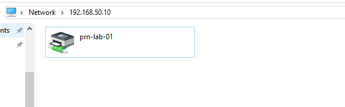 |
| 14 | Mở Notepad, gõ `Test print from PC-USER-02`, nhấn `Ctrl + P`, chọn **PRN-LAB-01 on Print-srv-01**, nhấn Print | 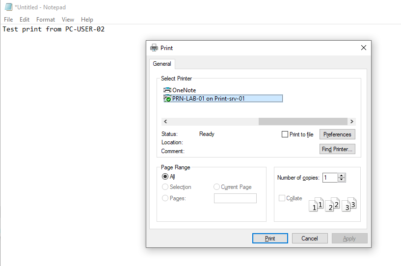 |
| 15 | Sang máy A: `type C:\PrintOut\output.txt` → xác nhận nội dung bản in đã đến | 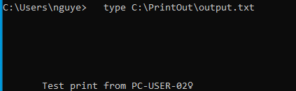 |
| 16 | Hàng đợi in trên máy A (PRN-LAB-01 → See what's printing): hàng đợi trống, xác nhận lệnh in đã xử lý xong | 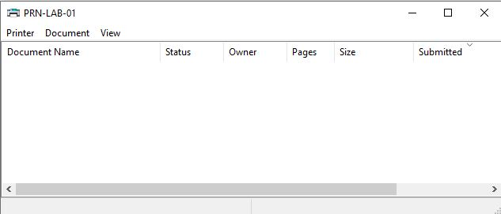 |
| 17 | Kiểm tra danh sách máy in trên máy B: Settings → Printers & scanners → xác nhận `PRN-LAB-01` đã được thêm | 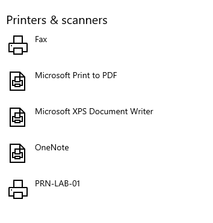 |

---

## Danh sách sự cố đã xử lý

> ⏳ **Chưa thực hiện – sẽ bổ sung sau khi hoàn thành Giai đoạn 4.**

| Mã | Sự cố | Ưu tiên | Nguồn | Trạng thái |
|---|---|---|---|---|
| P001 | Lệnh in kẹt trong hàng đợi | Trung bình | Tự tạo | 🔲 Chưa làm |
| P002 | Máy in báo lỗi / Offline khi server tắt nguồn | Cao | Tự tạo | 🔲 Chưa làm |
| P003 | Không thấy / truy cập được máy in trong mạng | Cao | Tự tạo | 🔲 Chưa làm |
| P004 | In báo không có quyền | Cao | Tự tạo | 🔲 Chưa làm |
| P005 | In xong không thấy giấy (in nhầm máy in mặc định) | Thấp | Tự tạo | 🔲 Chưa làm |
| P006 | In ra rồi nhưng không thấy kết quả (cổng sai) | Trung bình | Tự tạo | 🔲 Chưa làm |

---

## Giới hạn của lab

- Dùng máy in giả lập (driver Generic / Text Only, in ra file) nên không có lỗi vật lý như kẹt giấy, hết mực, hoặc driver của hãng cụ thể.
- Chưa thực hành với máy in thật trên mạng LAN thực tế.

---

## Bài học rút ra

- Máy in chia sẻ qua mạng cần ba điều kiện đồng thời: mạng thông (ping), cổng SMB mở (port 445), và quyền trên máy in đúng – thiếu bất kỳ điều nào cũng khiến in thất bại với thông báo lỗi khác nhau.
- Đặt mạng thành Private là bước không thể bỏ qua khi dùng Host-only: Windows mặc định đánh dấu mạng không có Internet là Public và chặn chia sẻ file/máy in.
- Máy in giả lập (in ra file) đủ để thực hành toàn bộ luồng chia sẻ, phân quyền và hàng đợi in – là lựa chọn thực tế khi không có máy in vật lý.
