# Lab 04: Mạng – Chẩn đoán lỗi và dựng mạng văn phòng nhỏ

## Mục tiêu

Dùng lệnh chẩn đoán mạng trên Windows để hiểu từng tầng kết nối từ máy ra
Internet, sau đó dựng một mạng văn phòng hai dải IP trên Cisco Packet Tracer
(router, switch, DHCP, DNS), rồi tự tạo và xử lý các lỗi mạng thường gặp.

## Môi trường

| Thành phần | Chi tiết |
|---|---|
| Máy ảo | VMware Workstation, Windows 10 Pro, card mạng **NAT** (để ra Internet) |
| Packet Tracer | Cisco Packet Tracer 8.2.2 |
| Sơ đồ lab | R1 (2911), 2 Switch (2960-24TT), 4 PC (PC-PT), 1 Server-PT |

---

## Giai đoạn 1: Lệnh chẩn đoán mạng trên Windows

Nguyên tắc: kiểm tra từ **gần đến xa** — máy mình → mạng nội bộ → Internet qua
IP → Internet qua tên. Mỗi bước thất bại cho biết lỗi ở tầng nào.

### Bảng lệnh và cách đọc kết quả

| # | Lệnh | Kiểm tra gì | Kết quả & ý nghĩa |
|---|---|---|---|
| 1 | `ipconfig /all` | IP, subnet, gateway, DNS, DHCP bật/tắt | Card `Ethernet0` có IP `192.168.40.128/24`, gateway `192.168.40.2`, DHCP: Yes — máy đang nhận IP tự động từ VMware NAT |
| 2 | `ping 127.0.0.1` | Ngăn xếp TCP/IP của máy có hoạt động không | 4/4 gói, < 1 ms — tầng mạng phần mềm bình thường |
| 3 | `ping 192.168.40.128` | Card mạng có nhận IP chưa | 4/4 — card đã up, IP hợp lệ |
| 4 | `ping 192.168.40.2` | Tới được gateway (VMware NAT) không | 4/4, < 1 ms — kết nối nội bộ ổn |
| 5 | `ping 8.8.8.8` | Ra được Internet bằng IP không | 4/4, RTT ~881 ms (NAT chậm) — Internet có, DNS chưa cần |
| 6 | `ping google.com` | DNS phân giải tên thành công không | Giải được `74.125.200.113`, 3/4 nhận — DNS ổn, 1 gói timeout bình thường với NAT |
| 7 | `tracert google.com` | Gói đi qua những chặng nào | Chặng 1: `192.168.40.2` (gateway VMware). Chặng 2–11: `*` (router giữa đường tắt ICMP TTL-exceeded). Chặng 12–13: `sa-in-f138.1e100.net` (Google). Dấu `*` không có nghĩa đứt mạng |
| 8 | `nslookup google.com` | DNS server nào trả lời, kết quả là gì | Server `192.168.40.2` (VMware NAT); giải được `google.com.localdomain → 142.250.66.110` |
| 9 | `arp -a` | Bảng ánh xạ IP và MAC trong mạng nội bộ | Thấy gateway `.2` và DHCP server `.254` có MAC dynamic; multicast/broadcast là static — ARP bình thường |
| 10 | `ipconfig /release` rồi `/renew` | Xin lại IP từ DHCP | Thả IP cũ, xin IP mới — kiểm tra DHCP server còn phản hồi không |
| 11 | `ipconfig /flushdns` | Xóa cache DNS | Buộc máy hỏi lại DNS server thật thay vì dùng bản ghi cũ đã lưu |

### Ảnh chụp – Giai đoạn 1

**📸 01 – ipconfig /all**
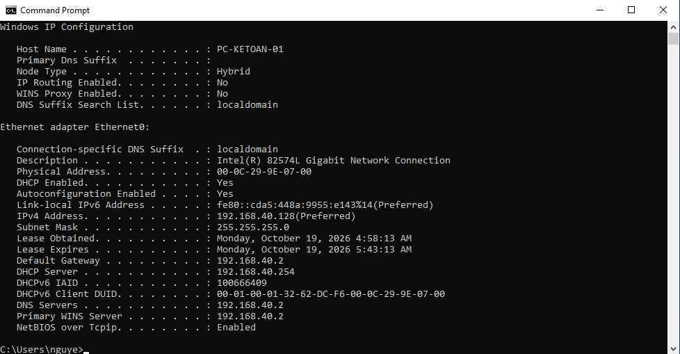

**📸 02 – Ping ladder (127.0.0.1 → gateway → 8.8.8.8 → google.com)**
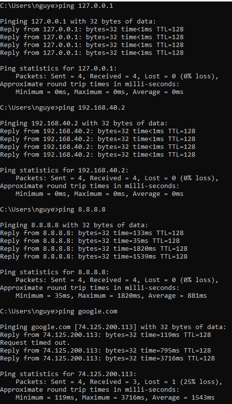

**📸 03 – tracert google.com**
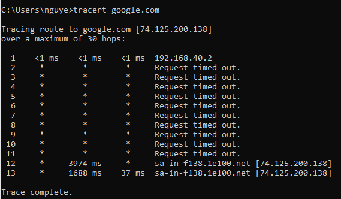

**📸 04 – nslookup google.com**
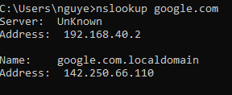

**📸 05 – arp -a**
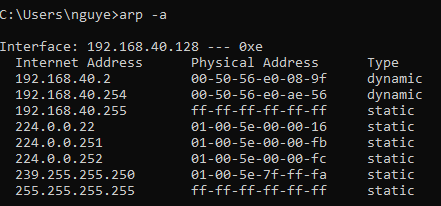

---

## Giai đoạn 2: Dựng mạng văn phòng nhỏ trên Packet Tracer

### Sơ đồ mạng

```
 PC1 ─┐                               ┌─ PC3
      ├─ Switch1 ── R1 ── Switch2 ────┤
 PC2 ─┘   (Kế toán)       (Kỹ thuật) ├─ PC4
                                      └─ Server (DNS)
```

### Bảng địa chỉ IP

| Thiết bị | Interface | IP | Subnet | Gateway |
|---|---|---|---|---|
| R1 | Gi0/0 | 192.168.10.1 | 255.255.255.0 | — |
| R1 | Gi0/1 | 192.168.20.1 | 255.255.255.0 | — |
| PC1 | Fa0 | 192.168.10.11 (DHCP) | 255.255.255.0 | 192.168.10.1 |
| PC2 | Fa0 | 192.168.10.12 (DHCP) | 255.255.255.0 | 192.168.10.1 |
| PC3 | Fa0 | 192.168.20.11 (DHCP) | 255.255.255.0 | 192.168.20.1 |
| PC4 | Fa0 | 192.168.20.12 (DHCP) | 255.255.255.0 | 192.168.20.1 |
| Server | Fa0 | 192.168.20.100 (static) | 255.255.255.0 | 192.168.20.1 |

### Bước 1 – Đặt thiết bị và nối dây

Kéo 1 Router 2911, 2 Switch 2960-24TT, 4 PC-PT, 1 Server-PT vào workspace.
Nối Copper Straight-Through: R1 Gi0/0 → Switch1; R1 Gi0/1 → Switch2;
PC1, PC2 → Switch1; PC3, PC4, Server → Switch2.

**📸 06 – Sơ đồ mạng trong Packet Tracer**
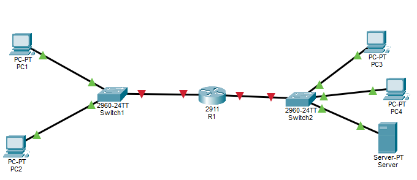

### Bước 2 – Cấu hình router R1 (CLI)

```
enable
configure terminal
hostname R1
interface gigabitEthernet 0/0
 ip address 192.168.10.1 255.255.255.0
 no shutdown
interface gigabitEthernet 0/1
 ip address 192.168.20.1 255.255.255.0
 no shutdown
end
copy running-config startup-config
```

Kiểm tra `show ip interface brief` — Gi0/0 và Gi0/1 phải trạng thái `up/up`.

**📸 07 – show ip interface brief sau khi cấu hình**
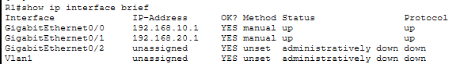

### Bước 3 – Đặt IP tĩnh cho PC

Vào `Desktop → IP Configuration → Static` trên từng PC theo bảng trên.

**📸 08 – IP tĩnh trên PC1**
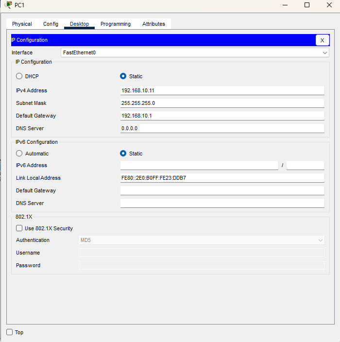

### Bước 4 – Kiểm tra thông mạng

Trên PC1 → `Desktop → Command Prompt`:

```
ping 192.168.10.12   ← cùng subnet (PC2)
ping 192.168.10.1    ← gateway
ping 192.168.20.11   ← sang subnet Kỹ thuật (PC3)
```

Lần ping đầu sang PC2 mất gói vì ARP chưa có MAC; ping lần 2 thông hết.

**📸 09 – Ping cùng subnet (PC1 → PC2, PC1 → Gateway)**
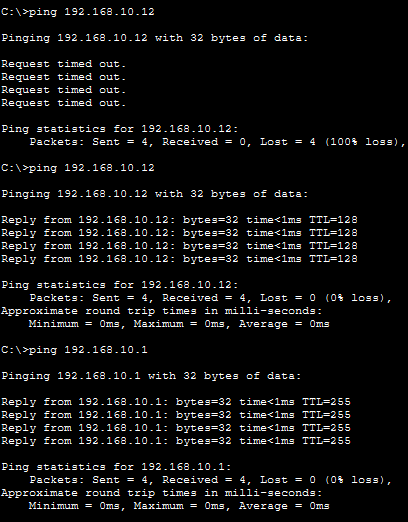

**📸 10 – Ping cross-subnet (PC1 → PC3)**
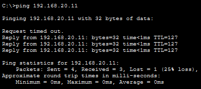

### Bước 5 – Cấu hình DHCP trên R1

```
enable
configure terminal
ip dhcp excluded-address 192.168.10.1 192.168.10.10
ip dhcp excluded-address 192.168.20.1 192.168.20.10
ip dhcp excluded-address 192.168.20.100
ip dhcp pool KETOAN
 network 192.168.10.0 255.255.255.0
 default-router 192.168.10.1
 dns-server 192.168.20.100
ip dhcp pool KYTHUAT
 network 192.168.20.0 255.255.255.0
 default-router 192.168.20.1
 dns-server 192.168.20.100
end
copy running-config startup-config
```

Đổi PC1, PC2, PC3 sang DHCP và chờ nhận IP (dải .11 trở lên).

**📸 11 – DHCP pool trong running-config**
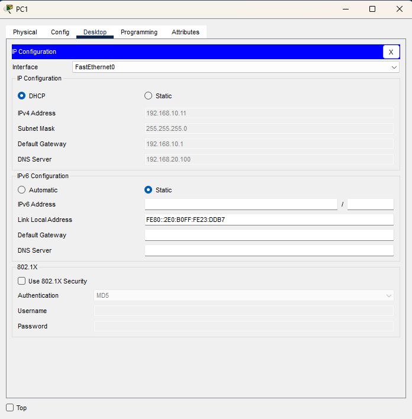

**📸 12 – PC1 nhận IP qua DHCP**
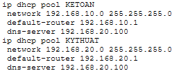

Kiểm tra bên router:

```
show ip dhcp binding
```

**📸 13 – show ip dhcp binding**
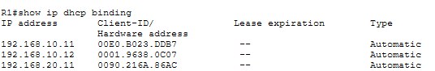

### Bước 6 – Cấu hình DNS

Trên Server → `Services → DNS → On`. Thêm bản ghi A:

| Name | Type | Address |
|---|---|---|
| web.lab.local | A Record | 192.168.20.100 |

**📸 14 – DNS server bật và có bản ghi A**
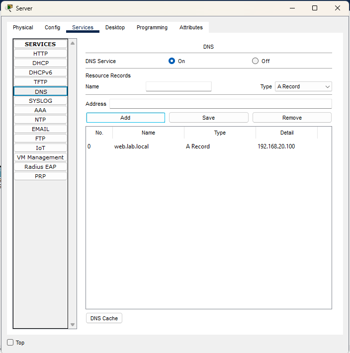

Trên PC1:

```
nslookup web.lab.local
ping web.lab.local
```

`nslookup` timeout lần đầu (ARP lần đầu với Server), lần sau giải được
`web.lab.local → 192.168.20.100`. `ping web.lab.local` 4/4 thành công.

**📸 15 – nslookup và ping web.lab.local**
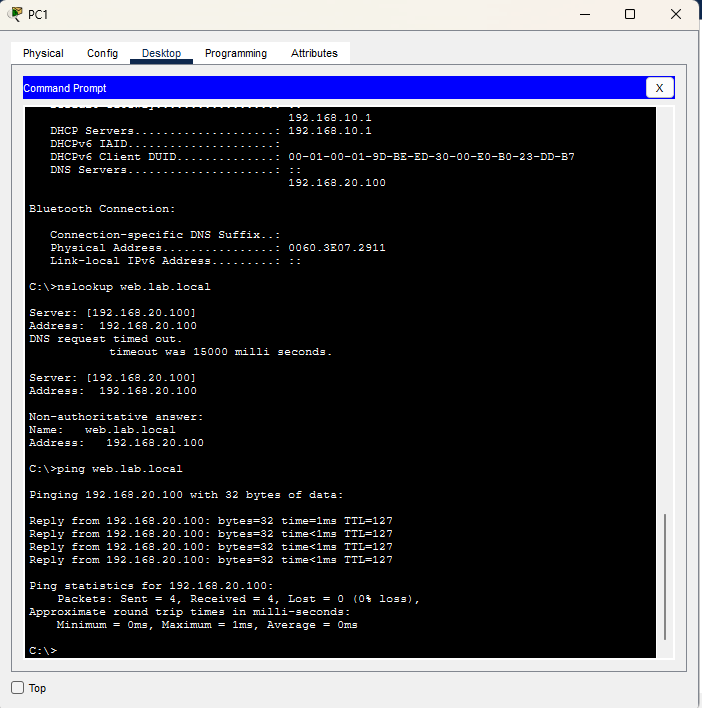

### File Packet Tracer

- [net-01-base.pkt](packet-tracer/net-01-base.pkt) — trạng thái đầy đủ sau khi cấu hình router, DHCP, DNS

---

## Danh sách sự cố đã xử lý

*(Phần ticket sẽ bổ sung sau)*

| Mã | Sự cố | Ưu tiên | Nguồn | Trạng thái |
|---|---|---|---|---|
| N001 | Vào web lỗi do sai DNS | Trung bình | Tự tạo | Chưa làm |
| N002 | Máy báo IP 169.254 — DHCP mất pool | Trung bình | Tự tạo | Chưa làm |
| N003 | Không sang subnet Kỹ thuật — sai gateway | Thấp | Tự tạo | Chưa làm |
| N004 | Mất mạng do rút dây / tắt card | Thấp | Tự tạo | Chưa làm |
| N005 | Tên miền bị chuyển hướng — file hosts sai | Cao | Tự tạo | Chưa làm |
| N006 | Ping được nhưng trình duyệt lỗi — proxy giả | Trung bình | Tự tạo | Chưa làm |
| N007 | Ping giữa hai máy không thông — tường lửa | Thấp | Thật (Lab 3) | Chưa làm |

---

## Giới hạn của lab

- Mạng Packet Tracer là **mô phỏng phần mềm**, không có phần cứng thật; một số
  hành vi (như timeout ARP lần đầu) có thể khác thiết bị thật.
- Chưa thực hành với router/switch vật lý, Wi-Fi, hay VLAN.
- `tracert` trên máy ảo NAT cho thấy nhiều chặng `*` — đây là hành vi bình
  thường của ISP chặn ICMP TTL-exceeded, không phải mạng đứt.

## Bài học rút ra

Thứ tự kiểm tra từ gần đến xa giúp khoanh vùng lỗi nhanh: nếu `ping 127.0.0.1`
thành công mà `ping gateway` thất bại thì lỗi ở card mạng hoặc cấu hình IP —
không cần đụng vào DNS hay Internet. Nếu `ping 8.8.8.8` thông nhưng
`ping google.com` không thông thì 100% lỗi DNS, không phải đứt đường truyền.
Việc dựng DHCP nội bộ trên Packet Tracer cho thấy rõ tại sao PC báo
`169.254.x.x` — đó là địa chỉ APIPA tự cấp khi DHCP không phản hồi, dấu hiệu
đầu tiên cần kiểm tra pool DHCP trên router.

